  

  
  
  
  

  

I design and ship full-stack products, agentic workflows and business automation: from the interface and data layer to the tools, guardrails and deployment. My work replaces manual operations with software people run every day.

## Flagship: Tabgeist

**Let any AI agent work in your own signed-in Chrome or Edge, while you keep the signals.**

- Risky steps (send, post, pay, delete) wait for your click. The agent cannot approve them.
- A task that worked once becomes a routine that replays without the AI, and heals itself when the site changes.
- Per-site memory, packs that read a site's own data, a timeline with a picture after every action, and `never_to` rules that block a person or number outright.
- Works with Claude Code, Codex, Cursor and any MCP agent. MIT, runs fully on your computer.

`npm install -g tabgeist` · [Repository](https://github.com/MuhammadAwais-Automation/tabgeist) · [npm](https://www.npmjs.com/package/tabgeist)

 

## Selected work

| Project | What it is | Proof |
|---|---|---|
| [PowerNet Manager](https://github.com/MuhammadAwais-Automation/powernet-manager) | ISP operations dashboard: customers, billing, complaints, staff roles, reports | Runs the operations of an ISP with **6,300+ active subscribers** |
| [PowerNet Staff App](https://github.com/MuhammadAwais-Automation/powernet-staff-app) | Flutter app for field teams, recovery agents, operators and customers | Mobile workflows on the same live backend |
| [FlowDesk](https://github.com/MuhammadAwais-Automation/FlowDesk) | Local-first Electron workstation for AI sessions, accounts and creator workflows | Claude Agent SDK agent, isolated sessions, browser worker queues |
| [Agentic OS](https://github.com/MuhammadAwais-Automation/agentic-os) | Local dashboard for agent sessions, MCP servers, approvals, memory and runs | Agent infrastructure over WebSockets and local bridges |
| [Orvion Labs](https://github.com/MuhammadAwais-Automation/orvion-labs) | Prompt management and regression testing | Async runs, realtime results, evaluation workflows |
| Accounts payable automation *(client work)* | Invoice capture, validation, PO matching, approvals and exceptions | Controlled handoff into Microsoft Dynamics 365 Business Central |

## What I work with

  

| Area | Tools |
|---|---|
| **AI and agents** | Claude Agent SDK, MCP servers, Claude and OpenAI APIs, agent orchestration, guardrails and human approval, evaluations |
| **Business systems** | Microsoft Dynamics 365 Business Central, CRM workflows, billing, approvals, reporting |
| **Automation** | n8n, Make.com, browser automation, scheduled jobs, API integration |
| **Product** | Next.js, React, TypeScript, Flutter, Electron, Supabase, PostgreSQL, Node.js |
| **Infrastructure** | Oracle Cloud ARM, Docker, Coolify, Nginx, SSL, WireGuard, self-hosted Ollama and Open WebUI |

## How I work

- **AI-first engineering.** Parallel agents do the typing; architecture, review and the final call stay human.
- **Local-first and safe by default.** Data stays with the user, risky actions ask first, every step leaves a receipt.
- **Ship what gets used.** Dashboards, field apps and automations that real teams run daily.

## Let's work together

Freelance projects, contracts and collaboration on AI agents, business automation and full-stack products.
Reach me on [LinkedIn](https://www.linkedin.com/in/awais-mushtaq-ab5442302).

